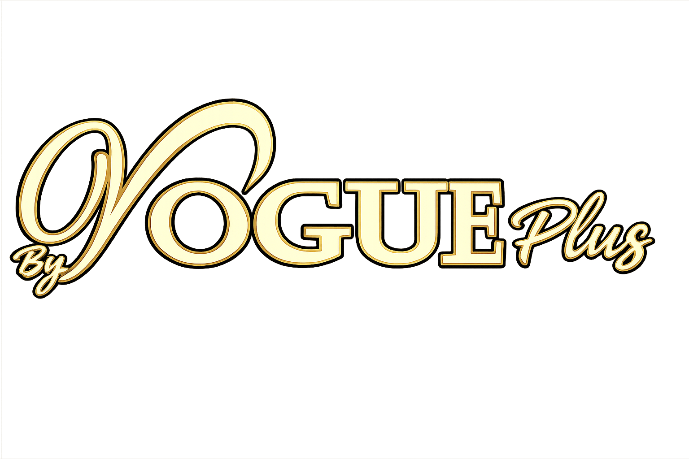

# Vogue Café Menu

A responsive digital café menu built with plain HTML, CSS and JavaScript. Visitors can browse food, drinks and desserts, view product images, and find the venue's contact and location details.



## Features

- Category navigation and product cards
- Menu prices and locally stored product images
- Responsive layouts for phones and larger screens
- Venue location map and social links

## Run locally

Clone the repository and open `index.html` in a browser. For a local HTTP preview, run `python -m http.server 8080` in the repository directory and visit `http://localhost:8080`.

There is no package installation or build step. Google Fonts, Font Awesome, the map and some display images require an internet connection.

## Project structure

```text
index.html   Page layout, styles, menu data and interactions
images/      Product photographs and branding
```

## Update the menu

Edit the `menuVerileri` object in `index.html`, keeping image paths relative to the page. Publish the HTML and `images/` directory together on a static host.

This repository is a static presentation. It does not include ordering, payment, authentication or a menu-management backend. Prices and availability are source data rather than a live inventory feed.

## Assets

Venue branding and product photographs are included for this project. No license granting reuse of those assets or the source code is declared in this repository.
